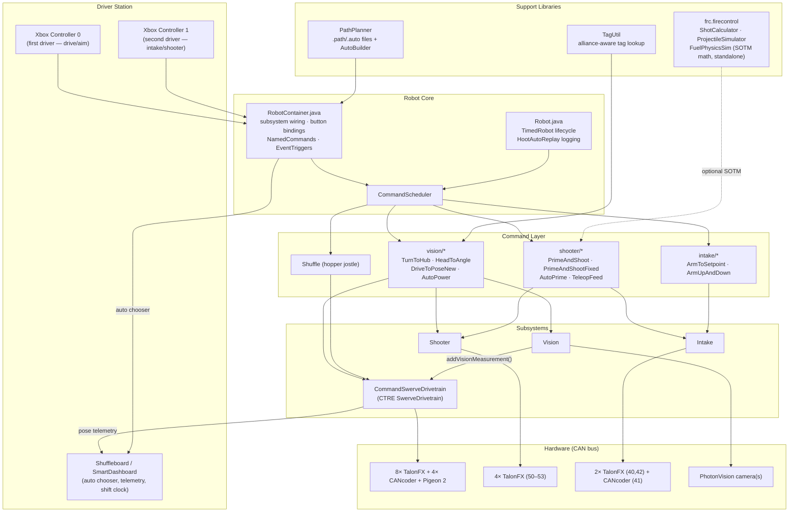
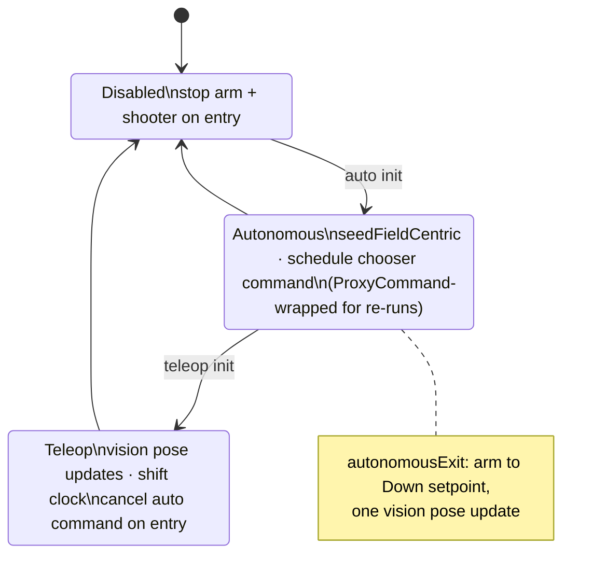
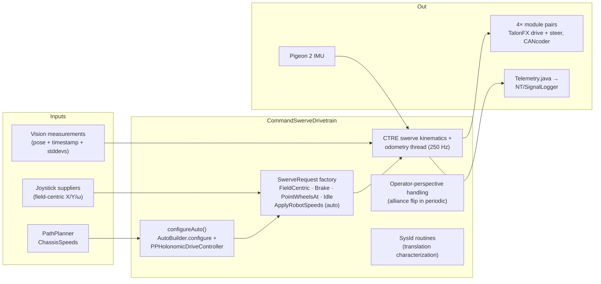
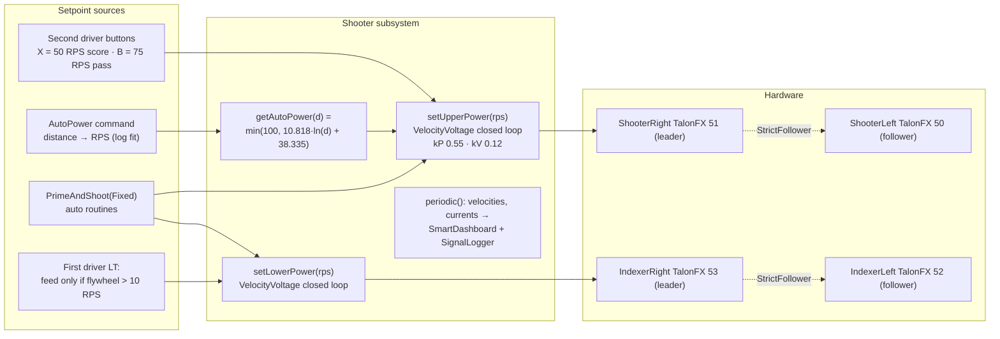
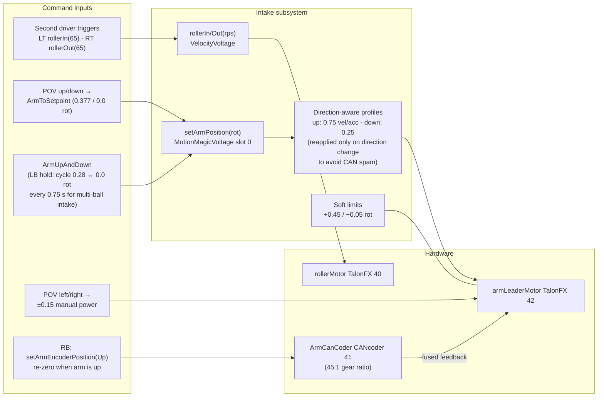
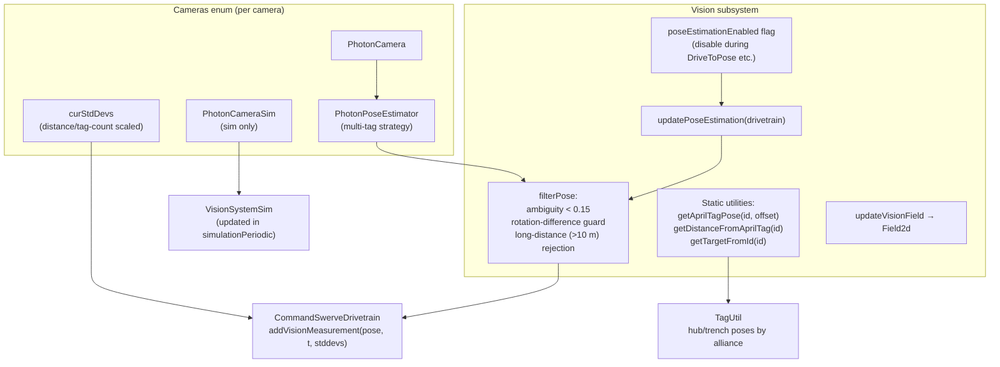
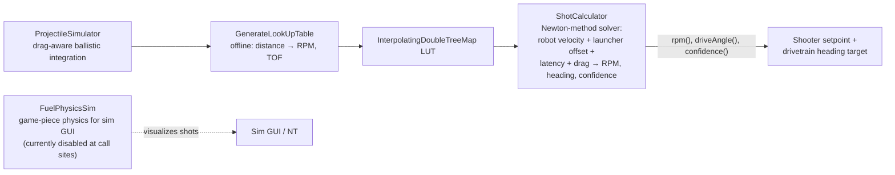
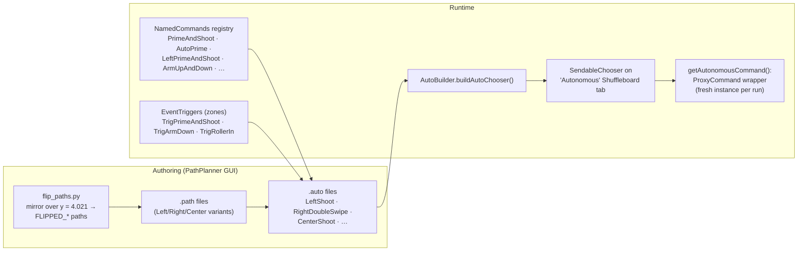
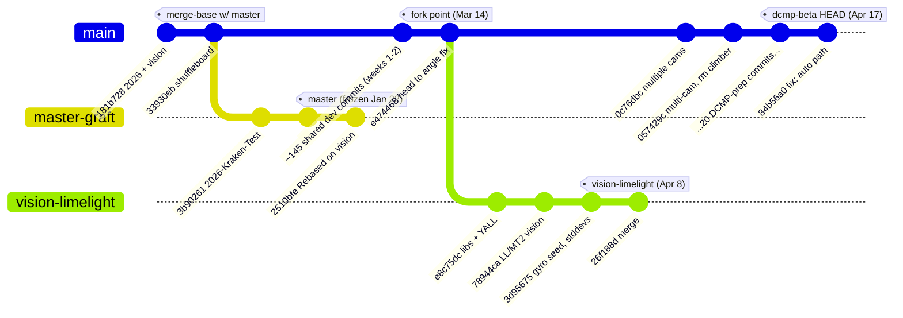

# FRC Team 3566 — 2026 Robot Software Design

Design document for the 2026 competition robot code (`2026-Test-Kraken`). Covers the
technology stack, overall software architecture, and the internal design of each subsystem.

---

## 1. Tech Stack

| Layer | Technology | Version | Role |
|---|---|---|---|
| Language | Java | 17 | All robot code |
| Framework | WPILib (command-based) | 2026 | Scheduler, subsystems, commands, units, dashboards |
| Build/Deploy | GradleRIO | 2026.2.1 | Build, test, deploy to roboRIO, desktop simulation |
| Motor control | CTRE Phoenix 6 | 26.1.1 | TalonFX (Kraken), CANcoder, Pigeon 2, swerve API, SignalLogger/Hoot |
| Path planning | PathPlannerLib | 2026.1.2 | Autonomous paths, autos, event triggers, auto chooser |
| Vision | PhotonVision (photonlib) | 2026 | AprilTag detection, multi-tag pose estimation, vision sim |
| Testing | JUnit 5 (Jupiter) | 5.10.1 | Unit tests via `./gradlew test` |
| Tooling | Python 3 | — | `flip_paths.py` path mirroring utility |
| Dashboards | Shuffleboard / SmartDashboard / Field2d | 2026 | Driver feedback, auto selection, telemetry |

**Hardware targeted by the code**

- Swerve drivetrain: 4 modules, TalonFX drive + steer, CANcoder azimuth encoders, Pigeon 2 IMU (via Tuner X generated `TunerConstants`)
- Shooter: 2× TalonFX flywheel (leader/follower) + 2× TalonFX indexer (leader/follower), CAN IDs 50–53
- Intake: 1× TalonFX roller (40), 1× TalonFX arm (42) with CANcoder feedback (41)
- Vision: PhotonVision coprocessor camera(s); USB driver camera through `CameraServer`

---

## 2. Overall Architecture

### Key data flows

1. **Pose estimation loop** — `CommandSwerveDrivetrain` fuses wheel odometry + Pigeon 2 at 250 Hz (CTRE internal thread). `Vision.updatePoseEstimation()` (called from `Robot.teleopPeriodic` / `autonomousExit`) filters PhotonVision results by ambiguity/rotation and injects them via `addVisionMeasurement()`.
2. **Aiming/shooting loop** — commands read `drivetrain.getState().Pose`, use `TagUtil` to find the alliance-correct hub tag, compute distance, and drive `Shooter` velocity setpoints (`Shooter.getAutoPower(distance)` log-fit, or the `frc.firecontrol` LUT solver).
3. **Autonomous** — PathPlanner `.auto` files sequence paths and reference `NamedCommands`/`EventTrigger` names registered in `RobotContainer.configureAutoCommand()`. `AutoBuilder` (configured inside the drivetrain with `PPHolonomicDriveController`) follows the paths.

### Mode lifecycle (Robot.java)

---

## 3. Subsystem Designs

### 3.1 CommandSwerveDrivetrain

Extends CTRE Phoenix 6 `SwerveDrivetrain` (generated wrapper `TunerSwerveDrivetrain`), implements WPILib `Subsystem`. Constructed by `TunerConstants.createDrivetrain()` — module gains, gearing, and offsets are Tuner X generated and should be regenerated, not hand-edited.

**Public surface used elsewhere:** `applyRequest(Supplier<SwerveRequest>)` (default teleop command), `getPose()` / `getState().Pose`, `resetPose()`, `getRobotRelativeSpeeds()` / `driveRobotRelative()` (PathPlanner hooks), `addVisionMeasurement()` (Vision), `samplePoseAt()` (latency compensation), `seedFieldCentric()`.

**Design notes**

- Teleop default command: open-loop `FieldCentric` request with 10% stick deadband; max speed comes from `TunerConstants.kSpeedAt12Volts`, max ω = 0.75 rot/s.
- Heading-assist commands (`TurnToHub`, `HeadToAngle`) wrap the same request with a rotation controller, keeping translation on the sticks.
- `Shuffle` issues a quick back/forth motion to jostle balls forward in the hopper.

### 3.2 Shooter

Two independent leader/follower TalonFX pairs: **flywheel** ("upper") and **indexer/feeder** ("lower"). Left motors are `StrictFollower`s of the right motors; all control targets the right/leader device.

**Design notes**

- All "power" values are **rotations per second (RPS)**, not percent output — `setUpperPower(50)` commands 50 RPS closed-loop.
- Flywheel current limits: 160 A stator / 80 A supply (config apply currently commented out — pending file-based config).
- Feed interlock: the teleop feed binding only runs the indexer once the flywheel is spinning (> 10 RPS), preventing dead-flywheel jams.
- Second driver A is the universal shooter cancel (stops both pairs, interrupts `AutoPower` via subsystem requirement).

### 3.3 Intake

Single roller + pivoting arm. The arm TalonFX uses a fused **CANcoder** (`FeedbackSensorSource`) so setpoints are in mechanism rotations, with Motion Magic profiles that differ by direction.

**Design notes**

- `ArmToSetpoint` finishes when within tolerance (default 0.02 rot) or after a 5 s timeout; `ArmUpAndDown` is the "swipe" intake motion used both in teleop (LB) and in autos (registered as a NamedCommand and raced against `PrimeAndShoot`).
- Auto event triggers `TrigArmDown` / `TrigRollerIn` map PathPlanner zone markers directly onto these methods.

### 3.4 Vision

PhotonVision-based global pose estimation with a camera enum pattern (each `Cameras` enum constant owns its `PhotonCamera`, `PhotonPoseEstimator`, std-dev state, and sim counterpart). Field layout: `k2026RebuiltAndymark`.

**Design notes**

- Pose updates are *pulled* by `Robot.teleopPeriodic()` (and once at `autonomousExit`) rather than run in `Vision.periodic()` — auto relies on wheel odometry + the PathPlanner starting pose, with vision re-converging in teleop.
- `TagUtil` is the semantic layer: enums like `Hub.FRONT_CENTER` hold blue/red tag ID pairs and `getTargettingId()` resolves the alliance at runtime; it also derives trench/neutral target poses for the `DriveToPoseNew` bindings.

### 3.5 Fire Control (`frc.firecontrol`)

Standalone shoot-on-the-move (SOTM) library (MIT-licensed, from Team 5962) with no WPILib subsystem dependencies — pure math plus NT publishing for sim.

**Design notes**

- `ShotCalculator.calculate()` iterates Newton's method (~2–3 iterations) to find the self-consistent time-of-flight where the velocity-projected aim point matches the LUT-predicted TOF.
- The competition code path currently uses the simpler `Shooter.getAutoPower()` log-fit equation; the fire-control solver is the higher-fidelity path available for SOTM.

---

## 4. Autonomous Design

**Rules that keep autos working**

- Every string in `NamedCommands.registerCommand()` / `new EventTrigger()` must exactly match the marker names in the PathPlanner GUI.
- Chooser selections are wrapped in `ProxyCommand` so auto can be re-run repeatedly during testing without restarting robot code (WPILib commands compose/schedule once).
- Fixed-power variants (`LeftPrimeAndShoot`, `RightPrimeAndShoot`, `CenterPrimeAndShoot`, trench/swipe) exist because field-position-derived power was inconsistent between field sides; `PrimeAndShoot` (pose-based) is the fallback when the field is accurate.

---

## 5. Telemetry & Diagnostics

- **SmartDashboard/Shuffleboard**: shooter velocities/currents, AutoPower distance/target, teleop shift clock with 5 Hz end-of-shift warning flash, robot velocity, auto chooser.
- **CTRE SignalLogger / Hoot**: shooter RPS, AutoPower inputs; `HootAutoReplay` records timestamp + joystick data for log replay of matches.
- **Telemetry.java**: swerve drive state (poses, module states) published for AdvantageScope-style viewing.
- **Simulation**: `simulateJava` runs the sim GUI with `VisionSystemSim` (camera model from `Constants.Vision.cameraProperties`) and optional `FuelPhysicsSim` ball physics.

---

## 6. Branch Analysis

Analysis of the three long-lived branches as of **2026-07-07**. Everything in
§1–§5 of this document describes **`dcmp-beta`**, the de-facto mainline.

### 6.1 Topology

(`master`'s 5 unique commits are pre-remote local-project history grafted on top of
`33930eb` by the "Rebased on vision" rewrite — not real divergent work.)

### 6.2 Current state

| Branch | Tip | Last activity | State |
|---|---|---|---|
| `master` | `2510bfe` "Rebased on vision" | Jan 22, 2026 | **Stale skeleton.** Only 8 commits total — history was squashed/rebased. Base swerve + early PhotonVision only: no Intake, no Shooter, no `frc.firecontrol`, no PathPlanner autos (12 Java files vs ~30 on dcmp-beta). 168 commits behind dcmp-beta. |
| `dcmp-beta` | `84b56a0` "fix: auto path" | Apr 17, 2026 | **Active competition codebase** (checked out, in sync with origin). Full robot: intake, shooter, fire control, multi-camera PhotonVision, all match autos, event-day fixes. |
| `vision-limelight` | `26f188d` (merge) | Apr 8, 2026 | **Dormant R&D spike**, remote-only. Forked from the dcmp lineage at `e474468` (Mar 14); 7 own commits, 23 commits behind dcmp-beta; never merged back. |

### 6.3 Diffs

**`master` → `dcmp-beta`** — `76 files, +11,337 / −815` (58 added, 15 modified, 3 deleted).
Effectively the entire season's development: `Intake`, `Shooter`, all
`commands/{intake,shooter,vision}`, the whole `frc.firecontrol` package, every PathPlanner
path/auto, `flip_paths.py`, Phoenix6 26.1.0→26.1.1, and the ~465-line multi-camera
`Vision.java` rework.

**fork point `e474468` → `vision-limelight`** — `14 files, +543 / −1,083`. A focused vision experiment:

- **`Vision.java` rewritten** (−728 lines net): PhotonVision `PhotonPoseEstimator` replaced
  with **Limelight + MegaTag2** via the **YALL** library (`limelight.Limelight`,
  `LimelightPoseEstimator` in `EstimationMode.MEGATAG2`, gyro/IMU seeding, MT2-style
  stddevs and basic filtering). Single camera `"limelight-2026-1"`. `VisionSystemSim` kept for simulation.
- Deleted dead vision commands: `ChaseTagCommand`, `LogTargetDistance`,
  `SupplyAprilTagFieldPose`, `SupplyAprilTagRobotTransform`.
- Added `vendordeps/yall.json`; upgraded **Phoenix6 to 26.1.3** (newer than dcmp-beta's
  26.1.1); added `elastic-layout.json`; updated field images.

**`vision-limelight` → `dcmp-beta`** (what the experiment is missing) — the 23 DCMP-prep
commits: multi-camera PhotonVision, climber removal, single/double swipe autos +
event-based priming, trench pathfinding to both sides, autopower equation retunes, swerve
constant fixes, brownout mitigation, current limits, cancoder offsets, `TunerConstants2`
(second drivebase). Conversely, dcmp-beta lacks VL's Phoenix 26.1.3 bump and YALL.

### 6.4 Branch purposes

- **`master`** — nominal default/PR-target branch, but in practice an abandoned January
  snapshot ("Rebased on vision" suggests it was reset to the `vision` branch's state early
  in the season and never advanced). The real integration line moved to per-event branches
  (`week-2`, `week-2-beta`, `week-2-safe`, `dcmp-beta`).
- **`dcmp-beta`** — the **District Championship (DCMP) competition branch**: live, tuned
  robot code with PhotonVision multi-camera pose estimation and all match autos. De-facto mainline.
- **`vision-limelight`** — an **R&D spike evaluating Limelight/MegaTag2 (via YALL) as a
  replacement for PhotonVision** pose estimation. Went dormant Apr 8 without merging; the
  mainline kept PhotonVision and went multi-camera instead.

### 6.5 Practical implications

1. **`master` is misleading as a PR base** — anything merged there would regress ~3 months
   of work. If the season is wrapping, fast-forwarding/resetting `master` to `dcmp-beta`
   would make the repo state honest.
2. **Merging `vision-limelight` into dcmp-beta is not a trivial merge** — `Vision.java`
   diverged in opposite directions (multi-camera PhotonVision vs single-Limelight MT2), and
   23 commits of path/auto/constants churn overlap. Cherry-picking the YALL vision layer
   onto current dcmp-beta would be cleaner than a merge.
3. **Phoenix6 versions differ** (26.1.1 on dcmp-beta vs 26.1.3 on vision-limelight) —
   align whichever direction the vision decision goes.

---

## 7. Competitive Improvement Analysis (dcmp-beta)

Deep-dive conducted **2026-07-07** against `84b56a0`. Findings ranked by match impact.
The detailed, step-by-step remediation plan for items 1–9 lives in **`PerformanceFix.md`**.

### 7.1 🔴 Tier 1 — Correctness/reliability issues that can directly lose matches

1. **Motor configs built but never applied** — `Shooter.java:54-57` and `Intake.java:98,110`
   comment out every `getConfigurator().apply(...)`. PID gains, **stator/supply current
   limits**, brake mode, RemoteCANcoder fusing, and soft limits all live only in the motor
   controllers' flash (Tuner X). A motor swap or factory reset at competition silently
   produces an unconfigured motor. Soft limits are `Enable = false` even in the dead config.
2. **`Shooter.getUpperVelocity()` returns duty cycle, not velocity** (`ShooterLeft.get() * 100`,
   `Shooter.java:124-126`). It gates the teleop feed interlock (`RobotContainer.java:199`,
   threshold 10 ≈ 10% duty) — balls can feed before the flywheel is at speed.
3. **Priming/feeding are open-loop timers** — `PrimeAndShoot`/`PrimeAndShootFixed` feed after
   `primeTime` seconds regardless of flywheel recovery between balls. First ball aimed,
   rest are lottery. No at-speed gate exists anywhere.
4. **`AutoPrime` doesn't prime** — the flywheel spin-up line is commented out
   (`AutoPrime.java:38-42`); it only runs the roller. Every auto pays full spin-up at each
   shooting stop (~0.5–1 s each).
5. **Missing `addRequirements`** on `PrimeAndShoot` (unlike its `Fixed` twin) and
   `ArmUpAndDown`. The universal shooter-cancel button cannot interrupt `PrimeAndShoot`;
   auto race groups work only by accident of which motors each command touches.
6. **Vision pose updates disabled in autonomous** (`Robot.autonomousPeriodic` commented out;
   one update at `autonomousExit`). Autos run on pure odometry — the probable cause of
   "right side need more power" (`RobotContainer.java:343`) and the proliferation of five
   hand-tuned `PrimeAndShootFixed` variants.

### 7.2 🟠 Tier 2 — Vision & localization quality

7. **Ambiguity filter doesn't filter the pose** (`Vision.java:283-295`) — it rebuilds
   `EstimatedRobotPose` with `goodTargets` but keeps the original `estimatedPose` computed
   from all targets, bad ones included. The filter only affects logging.
8. **Rotation gate is a no-op** — `maximumRotationDifferenceDeg = 180` can never reject
   (angle differences max out at 180°).
9. **Shared "lost robot" counter across all three cameras**
   (`longDistangePoseEstimationCount`) — any camera increments it, any camera resets it;
   re-acquisition behavior is nondeterministic.
10. **Heading never trusted from vision** (θ stddev = 360° on every camera) — pure gyro
    heading for the whole match; `TurnToHub` aims from odometry heading, so post-collision
    drift degrades aim.

### 7.3 🟡 Tier 3 — Architecture

11. **No ball-path sensing** — no beam break anywhere; forces timer-based shooting, blind
    rollers, no shoot-until-empty, no ball count. Highest-ROI hardware+software change.
12. **Shooting split across two drivers with no combined score action** (aim on driver 1's A,
    power mode on driver 2's X/B/Y, feed on driver 1's LT). All ingredients for a one-button
    aim-and-shoot supercommand already exist as separate commands.
13. **`frc.firecontrol` SOTM stack is dead weight** — a complete Newton-method
    shoot-on-the-move solver sits unused while the live path is a stationary log-curve fit.
    Wiring it in enables scoring while moving; needs items 1–6 first.
14. **Tuning constants scattered and hard-coded** — `autonomousPower=55`, `trenchPower=60`,
    `swipePower=65`, feeder 80/90 RPS, roller 65/70%, inline `54` — every pit retune is an
    edit+redeploy instead of a dashboard change.
15. **Duplicate/dead code** — `"SwipePrimeAndShoot"` registered twice
    (`RobotContainer.java:365-373`); `configureCamera()` defined but never called (no driver
    camera feed); `Constants.Swerve.MaxSpeed` unused; `TunerConstants` vs `TunerConstants2`.

### 7.4 🟢 Tier 4 — Subsystem refinements

- **Drivetrain**: `MaxAngularRate` 0.75 rot/s is conservative (1.25–1.5 typical); PathPlanner
  PID (5.0/0/0) is the stock value — verify against trench-run telemetry; `seedFieldCentric()`
  every `autonomousInit` assumes a driver-forward start.
- **Shooter**: flywheel configured `NeutralMode.Brake` (should coast); no kS in gains —
  SysId-measured kS improves between-ball recovery.
- **Intake**: slot comment/code disagreement in `setArmPosition` (Slot 1 documented "up",
  used for down — latent while gains are identical); `ArmToSetpoint.end()` stops the motor
  instead of holding position (arm sags under defense); roller "rps" params are actually
  duty cycle (`rps/100`); arm zeroing is a manual pre-match ritual despite the CANcoder
  absolute position already being on the dashboard.
- **Autonomous**: with feed gating + `AutoPrime` fixed, revisit the `waitSeconds(2.5)` /
  `shootTime 10` paddings — an estimated 2–4 s recoverable per auto.

### 7.5 🔵 Tier 5 — Process & verification

- **Zero tests** despite JUnit configured — `frc.firecontrol`, `TagUtil` alliance flipping,
  and `flip_paths.py` symmetry are pure logic begging for unit tests.
- **Simulation half-wired** — `FuelPhysicsSim` complete but commented out; `simulationInit`
  empty.
- **Logging** — log *commanded vs measured* flywheel velocity and feed events so missed
  shots are diagnosable in Hoot replays.

### 7.6 Priority order (effort → impact)

| # | Change | Effort | Match impact |
|---|---|---|---|
| 1 | Apply motor configs in code (+current limits, coast flywheel) | Low | Prevents catastrophic failure modes; brownout margin |
| 2 | Fix `getUpperVelocity` + velocity-gated feeding | Low | Multi-ball accuracy jump |
| 3 | Re-enable flywheel in `AutoPrime` | Trivial | ~1 s/shot saved in auto |
| 4 | Fix `addRequirements` (requires arm/roller subsystem split) | Low–Med | Eliminates nondeterministic control conflicts |
| 5 | Vision in auto (multi-tag-only) + real ambiguity/rotation filtering | Medium | Accurate pose-based shooting both sides; shorter autos |
| 6 | One-button aim-and-shoot supercommand | Medium | Faster teleop cycles, lower driver load |
| 7 | Beam-break sensing + shoot-until-empty | Medium (HW) | Seconds per cycle, smarter autos |
| 8 | NT-tunable shot constants | Low | Faster pit iteration |
| 9 | ShotCalculator integration (shoot-on-the-move) | High | Largest ceiling raise; needs 1–8 first |

---

## 8. Development Platform Analysis

Researched **2026-07-07** against the 2026-season toolchain.
**Team decision: development happens on a Mac M2 running macOS 26** — see §8.4 for what
that covers and the one Windows machine still required.

### 8.1 What "running this codebase" requires

Five distinct activities with different platform support:

1. **Build / deploy / simulate** the Java code (GradleRIO: `./gradlew build|deploy|simulateJava`)
2. **Author autos** (PathPlanner GUI editing `src/main/deploy/pathplanner/`)
3. **Configure hardware** (Phoenix Tuner X — swerve generation for `TunerConstants`, motor
   flash config, firmware; PhotonVision web UI)
4. **Drive the robot** (FRC Driver Station + NI Game Tools)
5. **Image / maintain the roboRIO** (NI roboRIO Imaging Tool)

### 8.2 Verified support matrix (2026 season)

| Tool | Windows | macOS | Linux |
|---|---|---|---|
| WPILib 2026 (VS Code, GradleRIO, sim GUI) | ✅ Win 10/11 64-bit | ✅ macOS 13.3+ (x64 & Apple Silicon) | ✅ Ubuntu 22.04+ |
| Gradle build/deploy of this repo | ✅ (`gradlew.bat`; `settings.gradle` handles Windows paths) | ✅ | ✅ |
| Phoenix 6 desktop sim natives (vendordep) | ✅ | ✅ | ✅ |
| PathPlanner GUI | ✅ (incl. MS Store auto-update) | ✅ | ✅ |
| PhotonVision dashboard | ✅ browser-based | ✅ | ✅ |
| Shuffleboard / Elastic / AdvantageScope | ✅ | ✅ | ✅ |
| `flip_paths.py` (Python 3) | ✅ | ✅ | ✅ |
| **Phoenix Tuner X** | ✅ Win 11 | ✅ **macOS 14.0+** | ❌ not supported (also iOS 15+/Android 9+) |
| **FRC Driver Station / NI Game Tools** | ✅ **Windows only** | ❌ | ❌ |
| **roboRIO Imaging Tool** | ✅ **Windows only** | ❌ | ❌ |
| roboRIO USB tether (RNDIS) | ✅ NI drivers | ⚠️ broken on macOS 13+ (Apple removed RNDIS) — use Ethernet/Wi-Fi | ⚠️ works, unofficial |

### 8.3 Per-platform verdict

- **Windows — the only 100%-coverage platform.** Everything runs natively, including the
  three 2026 Windows exclusives: Driver Station, Game Tools, roboRIO Imaging Tool. USB
  tether works via NI drivers. Competition rules effectively mandate the official Driver
  Station, so the team must own at least one Windows machine regardless of dev preference.
- **macOS — first-class for development** (build, deploy, sim, PathPlanner, PhotonVision,
  dashboards), and with macOS 14+ it also runs Phoenix Tuner X natively. Remaining caveat:
  **no USB tether** on macOS 13+ — deploy/debug over Ethernet or robot Wi-Fi (workflow
  difference, not a blocker). Cannot run Driver Station or the Imaging Tool.
- **Linux — fine for pure software work, weakest for robot ops.** Build/sim/PathPlanner/
  PhotonVision all work on Ubuntu 22.04+, but no Tuner X and no Driver Station. Community
  DS clones (QDriverStation, OpenDS) are **not competition-legal** (R710/R901).

Ranking for this repo's full workflow: **Windows > macOS 14+ > Linux**. For code-only
contributors who never touch the robot, all three are equal — the codebase itself is fully
cross-platform (Gradle wrapper committed, OS-branching `settings.gradle`, no OS-specific
Java code).

### 8.4 Team setup: Mac M2 (macOS 26) as the dev machine

The designated dev machine — **Apple Silicon M2, macOS 26** — clears every macOS version
floor (WPILib 2026 needs 13.3+, Tuner X needs 14.0+), so it covers natively:

- ✅ Build, deploy, unit tests, desktop simulation (WPILib ships Apple Silicon natives)
- ✅ PathPlanner GUI, PhotonVision dashboard, Shuffleboard/Elastic/AdvantageScope
- ✅ **Phoenix Tuner X** — including the flash-config snapshot required by
  `PerformanceFix.md` Fix 1, Step 1.1
- ✅ `flip_paths.py` and all repo tooling

Operating notes for this machine:

1. **Connect to the roboRIO over Ethernet or robot Wi-Fi, never USB** — macOS has no RNDIS
   support, so the USB tether will not appear as a network device. A USB-C Ethernet adapter
   in the pit is the practical fix.
2. **One Windows laptop remains mandatory** for Driver Station / Game Tools / roboRIO
   Imaging Tool. Keep it as the drive/pit machine; the Mac never needs those roles.
3. The Windows-only constraint largely dissolves next season — the **2027 Driver Station is
   announced as cross-platform** (Windows/macOS/Linux, x64+arm64) — so don't over-invest in
   Windows-side tooling now.

Sources: [WPILib installation guide](https://docs.wpilib.org/en/stable/docs/zero-to-robot/step-2/wpilib-setup.html) ·
[WPILib 2026 kickoff release](https://wpilib.org/blog/2026-kickoff-release-of-wpilib) ·
[Phoenix Tuner X docs](https://v6.docs.ctr-electronics.com/en/stable/docs/tuner/index.html) ·
[FRC Game Tools](https://docs.wpilib.org/en/stable/docs/zero-to-robot/step-2/frc-game-tools.html) ·
[Control system software overview](https://docs.wpilib.org/en/stable/docs/controls-overviews/control-system-software.html) ·
[2027 Driver Station announcement](https://wpilib.org/blog/the-2027-first-driver-station) ·
[PathPlanner releases](https://github.com/mjansen4857/pathplanner/releases) ·
[roboRIO network troubleshooting](https://docs.wpilib.org/en/stable/docs/networking/networking-introduction/roborio-network-troubleshooting.html)

---

## 9. LLMs for Robotic Reasoning — Feasibility Study

Researched **2026-07-07**. Question: can LLMs be leveraged for route planning, drive
control, shooting decisions, or other use cases in FRC competition?

**Verdict: LLMs are infeasible and illegal in the real-time, in-match control loop — and
feasible plus genuinely valuable everywhere around it.** Classical control on the robot;
LLM intelligence in the pit, the codebase, and the strategy room.

### 9.1 The three constraints that decide everything

**⏱ Control-loop timing.** This codebase runs hard real-time loops LLMs cannot touch:

| Loop | Frequency | Budget | Measured LLM reality |
|---|---|---|---|
| CTRE swerve odometry/control | 250 Hz | 4 ms | Multimodal LLM robot systems average **~785 ms** end-to-end (562 ms pure inference) |
| WPILib command scheduler | 50 Hz | 20 ms | ~40× too slow before network latency |
| Shooter feed gate (PerformanceFix #2) | 50 Hz | 20 ms | — |

Even state-of-the-art dual-system VLA architectures (NVIDIA GR00T N1, 2025) concede the
point: a diffusion policy runs "System 1" at ~10 ms while the language model is a slow
"System 2" planner. Action-chunking research documents jerky discontinuities at chunk
boundaries. **FRC's System 1 already exists — Phoenix 6 closed loops +
`PPHolonomicDriveController` — and outperforms any VLA at its job.**

**📡 FRC rules.** The only permitted in-match robot communication is the field-provided
radio (VH-109, per-event encryption), limited to control/debugging/telemetry with
bandwidth caps (R707 family). **A cloud LLM API call from robot code during a match is a
rules violation.** On-robot coprocessors are legal, but—

**🖥 On-robot compute.** roboRIO 2 (dual A9, ~512 MB) runs no LLM. A legal Jetson-class
coprocessor runs a quantized 1–3 B model at a few tokens/sec — **seconds per decision**
against state machines that decide in microseconds. No match decision justifies a
1,000–100,000× latency penalty.

### 9.2 Use-case feasibility

| Use case | Verdict | Reasoning |
|---|---|---|
| **Drive control (in-match)** | 🔴 Never | Solved optimally by PID/FF at 250 Hz; LLMs fail latency, determinism, and verifiability. Would *unsolve* a solved problem. |
| **Shooting decision (in-match)** | 🔴 Never | "Shoot now?" = flywheel-at-speed ∧ heading-error < 2° ∧ pose-confidence — a 3-term boolean at 50 Hz (PerformanceFix Fixes 2/6). The hard part (RPM + lead angle while moving) is ballistics, already solved by `ShotCalculator`'s Newton solver in 2–3 arithmetic iterations. LLM has no information advantage. |
| **Route planning (in-match)** | 🔴 No | PathPlanner's A* over `navgrid.json` replans in ms, deterministically, legally. Benchmarks: GPT-4o is poor at zero-shot path planning; LLM success degrades to ~80% with obstacle count; LLM-in-the-loop A* hybrids produce *more* failed paths than A* alone. |
| **Route planning (offline authoring)** | 🟡 Qualified yes | `.path`/`.auto` are JSON; LLMs can draft variants, mirror/transform (cf. `flip_paths.py`), and check waypoint consistency. Pattern from literature: **LLM as advisor, never planner-in-the-loop** — LLM proposes, `simulateJava` validates, a human approves. |
| **Match strategy & scouting** | 🟢 Adopt — highest leverage | Off-robot, between matches: scouting + TBA/Statbotics data → per-opponent briefs, pre-match auto-chooser advice, alliance pick-lists with justification, post-match summaries. Improves decisions without touching the robot. |
| **Development & code reasoning** | 🟢 Adopt — demonstrated | This document's §7 came from LLM analysis that surfaced real match-losing bugs (duty-cycle-as-velocity, unapplied configs, non-priming `AutoPrime`). Sustained uses: pre-event code review, test generation for `frc.firecontrol`, per-match Hoot/SignalLogger log analysis. |
| **Perception** | 🟡 ML yes, LLM no | Real-time game-piece detection is a solved small-CNN problem: Limelight Neural Detector on Coral/Hailo, free H100 cloud training for FRC teams. A ~1 Hz coprocessor VLM adds nothing over a bounding box. (Limelight's own LLM feature — the SnapScript *generator* — is dev-time, not runtime; the vendor reached the same conclusion.) |
| **NL driver commands (in-match)** | 🔴 Gimmick | A button press is a 20 ms intent channel with 100% precision. |

### 9.3 Mapping the research frontier to FRC

The 2025–26 literature converged on a hierarchy — System 2 (LLM/VLM semantic planner,
0.1–1 Hz) over System 1 (learned/classical policy, ~100 Hz). FRC's translation is stark
because the game is *fixed and known at kickoff*: the open-world semantic planning a
household robot needs an LLM for **does not exist in FRC**. The System-2 layer here is
the humans + strategy pipeline — that's where the LLM belongs. The System-1 layer is
Phoenix 6 + PathPlanner + interlocks, already optimal. This matches the
InteLiPlan/LLM-Advisor conclusions even for general robotics: lightweight, human-in-loop,
advisory roles.

### 9.4 Adoption roadmap for Team 3566

| Priority | Initiative | Legality | Effort | Win impact |
|---|---|---|---|---|
| ✅ Now | LLM-assisted dev: code review, `PerformanceFix.md` execution, test generation | N/A (off-robot) | Ongoing | High (indirect) |
| ✅ Now | Post-match log-analysis agent over Hoot/SignalLogger exports | Legal | Low | High |
| ✅ Now | Scouting→strategy pipeline (TBA/Statbotics + scouting sheets → briefs, auto-selection advice) | Legal | Medium | **Highest** |
| 🟡 Season | LLM-drafted PathPlanner paths, validated in `simulateJava` before deploy | Legal (offline) | Low | Medium |
| 🟡 Season | Limelight Neural Detector game-piece tracking (ML, not LLM) | Legal | Medium | Medium |
| ❌ Never | LLM in drive/shoot/plan control loops; cloud calls from robot code | Illegal in-match; 100–100,000× too slow | — | Negative |

**One-sentence verdict:** in FRC, LLMs can't drive the robot — but they can help the
*team* out-engineer and out-strategize the field, and that's where every hour of LLM
investment should go.

Sources: [Multimodal LLM robot control latency (ScienceDirect)](https://www.sciencedirect.com/science/article/pii/S2667241326000054) ·
[Pure VLA survey (arXiv 2509.19012)](https://arxiv.org/html/2509.19012v1) ·
[VLA concepts/progress/challenges (arXiv 2505.04769)](https://arxiv.org/html/2505.04769v2) ·
[Foundation models for robotics — GR00T dual-system](https://rohitbandaru.github.io/blog/Foundation-Models-for-Robotics-VLA/) ·
[LLM-Advisor path-planning benchmark (arXiv 2503.01236)](https://arxiv.org/abs/2503.01236) ·
[3P-LLM path planning (arXiv 2403.18778)](https://arxiv.org/abs/2403.18778) ·
[InteLiPlan (arXiv 2409.14506)](https://arxiv.org/pdf/2409.14506) ·
[LLM task planning for service robots — review (arXiv 2510.23357)](https://arxiv.org/html/2510.23357v1) ·
[FRC Rule R707 (FRCTools)](https://frctools.com/2025/rule/R707) ·
[FMS whitepaper — field network](https://fms-manual.readthedocs.io/en/latest/fms-whitepaper/fms-whitepaper.html) ·
[Limelight neural network trainer](https://tools.limelightvision.io/neural-network-trainer) ·
[WPILib vision coprocessors](https://docs.wpilib.org/en/stable/docs/software/vision-processing/wpilibpi/using-a-coprocessor-for-vision-processing.html)

---

## 10. Robot→Driver Bluetooth Link — Feasibility Study

**Question investigated:** can we add Bluetooth hardware to the robot ("vehicle
motherboard" — roboRIO or any onboard board) to communicate with the driver behind
the driver-station wall during a match?

**Verdict: ❌ No. It is illegal under three separate 2026 rules, would fail robot
inspection, and would be unreliable even if legal. The sanctioned FMS link already
carries a legal robot→driver channel — use rumble, LEDs, and dashboard audio instead.**

### 10.1 The rules kill it on both ends of the link

| Rule (2026) | Scope | What it says |
|---|---|---|
| **R702** | Robot radio | The Vivid Hosting **VH-109** wireless bridge "is the *only* permitted device for communicating to and from the ROBOT during the MATCH." |
| **R706** | Control signals | All control signals must originate from the OPERATOR CONSOLE and travel over the ARENA Ethernet/FMS network. |
| **R707** | Robot wireless | The only wireless allowed to/from/within the ROBOT: (A) the R702/R706 system, (B) event-provided location tags, (C) RFID/NFC used *exclusively within* the robot. Cameras and beam-break/IR sensors are explicitly *not* wireless devices — that's the whole carve-out, and Bluetooth isn't in it. |
| **R905** | Operator console | "No other form of wireless communications shall be used to communicate to, from, or within the OPERATOR CONSOLE" — the manual's own examples of prohibited devices are **active wireless network cards and Bluetooth devices**. (Same rule that forces Xbox controllers to be wired.) |
| **E301/E302** | Venue | Teams may not set up their own wireless networks at the venue (hotspots count as access points), and may not interfere with FIRST's or other teams' wireless. |

**Consequences of trying:** robots are inspected against every R-rule, so an
installed Bluetooth radio is an inspection failure before the first match. Discovered
mid-match it reads as circumventing the FMS — re-inspection at minimum, yellow/red-card
territory at worst. (Bluetooth headphones in the pit/stands are tolerated in practice;
anything transmitting to/from the robot or console is not.)

### 10.2 Even if legal, the physics is against it

- **Spectrum:** Bluetooth lives at 2.402–2.480 GHz. An FRC venue is one of the most
  hostile 2.4 GHz environments anywhere — hundreds of phones, hotspots, and laptops.
  It is precisely why FIRST moved the robot link off 2.4/5 GHz onto **Wi-Fi 6E at
  6 GHz** with the VH-109. A Bluetooth link would be the least reliable radio in the
  building.
- **Range:** Class 2 modules (HC-05/ESP32 class) are ~10 m nominal, less through the
  polycarbonate DS wall and a metal-dense field. The field is ~16.5 m long — a far-side
  robot sits at or past usable range. Class 1 (~100 m) exists but widens the
  interference footprint (and the inspection conversation).
- **Brownouts:** Bluetooth re-pairing after a power dip takes seconds. This robot has
  fought brownouts already (commit `cc85063`); a link that drops on every voltage sag
  is worse than nothing.

### 10.3 Legal alternatives that achieve "robot talks to driver"

The FMS link is bidirectional and teams may send anything over NetworkTables and the
joystick HID protocol — the legal channel already exists and this codebase uses part
of it.

| Channel | Mechanism | Effort | Use for |
|---|---|---|---|
| 🟢 **Controller rumble** | `CommandXboxController.setRumble()` — robot→DS over FMS, DS→controller over USB. Haptics straight to the driver's hands. | ~1 hr, zero hardware | Pulse on `isUpperAtSpeed()`, buzz on ball acquisition (pairs with the Fix 7 beam break in `PerformanceFix.md`), double-pulse at shift boundaries |
| 🟢 **Dashboard audio/visual** | Already publishing `Teleop/Shift Warning` flashing at 5 Hz from `Robot.setTeleopShifts()`; a dashboard like Elastic or a small NT-listener script can play sounds through the DS laptop speaker | Low | Shift warnings, at-speed chime, vision-lock tone |
| 🟢 **Robot LEDs** | CTRE CANdle or addressable strip driven from the roboRIO — the standard "robot signals humans" channel | Medium (hardware) | Color-coded intake-loaded / at-speed / vision-locked, visible to driver *and* human player |
| 🟢 **Drive coach voice** | The only unrestricted wireless protocol in FRC | Free | Everything else |

**One-sentence verdict:** a Bluetooth radio on the robot fails inspection under
R707/R905 and would drown in the venue's 2.4 GHz noise anyway — rumble + LEDs +
dashboard audio deliver the same driver-communication goals entirely within the rules.

Sources: [2026 Game Manual (official PDF)](https://firstfrc.blob.core.windows.net/frc2026/Manual/2026GameManual.pdf) ·
[R702/R706/R707 — 2026 manual mirror](https://www.frcmanual.com/2026/robot-construction-rules-(r)) ·
[R905 (FRCTools)](https://frctools.com/2025/rule/R905) ·
[E301/E302 — 2026 Event Rules](https://www.frcmanual.com/2026/event-rules-(e)) ·
[2026 Inspection Checklist](https://firstfrc.blob.core.windows.net/frc2026/Manual/2026FRCInspectionChecklist.pdf) ·
[VH-109 radio docs — Wi-Fi 6E](https://frc-radio.vivid-hosting.net/) ·
[Chief Delphi — Bluetooth in stands and pit](https://www.chiefdelphi.com/t/bluetooth-in-stands-and-pit/413886) ·
[Chief Delphi — earpieces during competition](https://www.chiefdelphi.com/t/use-of-earpieces-during-competition/154169)

---

## 11. 2026 Rules Deep-Dive & 2027 Outlook — Hardware/Software Roadmap

Deep-dive of the official 2026 REBUILT manual (via frcmanual.com mirror + WPILib docs)
mapped against this codebase, plus the **confirmed** 2027 control-system changes. The 2026
items are tactical; the 2027 items decide whether next season starts with a migration crisis.

### 11.1 2026 rules audit — what the code already gets right

- **Shift clock verified correct.** The manual defines TELEOP as 2:20 — Transition
  2:20–2:10, Shifts 1–4 at 25 s each (2:10 → 1:45 → 1:20 → 0:55 → 0:30), Endgame
  0:30–0:00. `Robot.setTeleopShifts()` uses boundaries 130/105/80/55/30 — an exact match.
- **Compliant by construction:** R702/R707 wireless (see §10), R502 max 4 propulsion
  motors (4 Kraken drive motors are exactly at the limit; steer motors don't count),
  R609 single 120 A main breaker, R701 roboRIO. Cameras and coprocessors are explicitly legal.

### 11.2 Rule limits worth pinning to the wall

| Rule | Limit | Relevance to this robot |
|---|---|---|
| G303 | Max **8 FUEL** preloaded at match start | Autos should assume/exploit a full 8-ball preload |
| G403 | No opponent contact when fully across the centerline in AUTO | Constrains `flip_paths.py` output and any far-side auto |
| G408 | No re-controlling fuel released by the HUB until it touches something else first | Affects intake behavior near our own hub outflow |
| R103/R104 | 115 lb; 110 in perimeter, 30 in starting height | Weight budget for a climber addition |
| **R107** | **30.0 in hard height cap for the whole match** — no tower exception | Climber must grab and hang within 30 in; no elevator-style extension |
| R704 | **7.0 Mbps** total radio bandwidth | Three PhotonVision cameras (RAY/DINGYI/LEO) at default stream settings can eat this — cap stream res/FPS in the PhotonVision UI |
| R614 | COTS computing devices may run on their own ≤100 Wh USB-PD battery pack | Vision coprocessor can come **off the 12 V rail** — direct brownout mitigation (see `cc85063` history) |
| RPs | ENERGIZED = 100 fuel · SUPERCHARGED = 360 fuel · TRAVERSAL = 50 tower points | Drives §11.4 climber priority and the RP dashboard |

### 11.3 2026 software improvements (→ `PerformanceFix.md` Fix 10)

1. **Hub-active tracking — the biggest untouched software win.** FMS sends
   `DriverStation.getGameSpecificMessage()` = `"B"` or `"R"` at teleop start (the alliance
   that won AUTO); combined with `getMatchTime()` this fully determines whether *our* hub
   is active in every shift. The code computes shift names but not hub state — drivers
   must remember the alternation themselves. During inactive shifts, fuel shot into our
   hub is **wasted**; the robot should intake/stockpile/pass. A ~30-line extension to
   `setTeleopShifts()` publishes "SHOOT" vs "STOCKPILE/PASS" plus a rumble pulse on
   transitions (the legal driver channel from §10.3). Specced as **Fix 10** in
   `PerformanceFix.md`.
2. **RP-aware endgame dashboard.** A running fuel-count estimate (shot counter from the
   Fix 7 beam break) displayed against the 100/360-fuel RP thresholds turns the endgame
   "keep shooting vs go climb" call from guesswork into arithmetic.
3. **Bandwidth audit.** Nothing in the repo pins camera stream settings; verify the three
   cameras' dashboard streams total <7 Mbps (R704) or vision degrades exactly when the
   field is busiest. (Checklist item in Fix 10.)

### 11.4 2026 hardware considerations

- **Climber is the gap.** `Constants.Climber` holds two dead setpoints — no subsystem, no
  motor ID, no binding. Tower points: L1 = 10, L2 = 20, L3 = 30 in teleop (L1 = 15 in
  AUTO, max 2 robots); two robots at L2+L3 reach the 50-point TRAVERSAL RP alone. Under
  R107's hard 30 in cap the design space is "reach ≤30 in, grab, winch and hang" — a
  Kraken + ratchet winch fits the 115 lb budget. Highest-value hardware addition the
  rules reward.
- **Power budget.** Drive motors run 90 A stator / 40 A supply limits
  (`TunerConstants`); the shooter's 80 A supply limits exist in code but are **commented
  out** (re-enabled by Fix 1). Against one 120 A main breaker and the documented brownout
  history, Fix 1 plus moving the vision coprocessor to an R614 battery pack is the
  cheapest brownout mitigation available.
- **Driver signaling LEDs** (CTRE CANdle) — see §10.3; pairs with the hub-active tracker.

### 11.5 2027 — confirmed changes and repo impact

Official per WPILib docs/blog and CTRE 2027 alphas — not speculation:

| 2027 change | Impact on this codebase |
|---|---|
| **SystemCore replaces roboRIO** (Raspberry Pi CM5, quad A76, 4 GB RAM, real-time Linux, 5 native CAN buses, Smart IO, onboard IMU, **integrated Limelight vision**) | R701 hardware is end-of-life after 2026. Multiple CAN buses = drivetrain gets its own bus without a CANivore. The Fix 7 DIO beam break maps to Smart IO. |
| **SmartDashboard and Shuffleboard removed** (NT3-based) | Heaviest migration: `SmartDashboard.put*` is everywhere (`Robot`, `Shooter`, `Vision`, commands) and the auto chooser lives on a Shuffleboard tab. Mitigation available *now*: adopt **Elastic** + NT4 publishers/Epilogue during 2026 — works this season, shrinks the 2027 diff dramatically. |
| **Java 25 required; `edu.wpi.first` → `org.wpilib`; `frc::` → `wpi::`** | Project is Java 17; every import changes. WPILib's VS Code importer automates most of it — for projects in good shape. |
| **Commands v3 + FTC-style OpModes added** | Commands v2 remains — the command-based architecture survives; no rewrite, but re-test the `ProxyCommand` auto-chooser pattern under v3. |
| **PathWeaver, RobotBuilder removed** | No impact — team is on PathPlanner (on the recommended list). |
| **Cross-platform 2027 Driver Station** | Retires the Windows-only DS constraint from §8 — the Mac M2 becomes viable for everything except legacy imaging. |
| **Phoenix 6 2027 alphas (26.50.0-alpha)** | Breaking: device constructors require a `CANBus` object (`CANBus.systemcore(int)`); string-bus and bus-less constructors are gone — every `new TalonFX(id)` changes. CANivore supported; Motioncore buses not yet. |
| **Removed hardware APIs** (relay, analog out, SPI, ADIS/ADXRS IMUs, interrupts, counters, analog triggers) | No impact — this robot is all-CAN (Pigeon 2, CANcoder, TalonFX); the all-CTRE architecture is exactly the safe side of this cut. |
| **SystemCore's built-in Limelight stack** | The dormant `vision-limelight` branch (§6) stops being a dead spike — its Limelight/MegaTag2 knowledge becomes the native 2027 vision path. **Don't delete it.** |

### 11.6 Recommended sequencing

| When | Action |
|---|---|
| 🔴 This season | Fix 10 hub-active tracker · PerformanceFix Fixes 1–6 · R704 bandwidth audit · climber build (hardware) |
| 🟡 Post-season | Elastic/NT4 dashboard migration — kill every `SmartDashboard`/Shuffleboard call while it's cheap |
| 🔵 2027 kickoff | VS Code importer (Java 25 / `org.wpilib`) + Phoenix 26.50 `CANBus` migration on a branch · resurrect `vision-limelight` learnings for SystemCore integrated vision |

Sources: [2026 Game Details](https://www.frcmanual.com/2026/game-details) ·
[2026 Game Rules (G)](https://www.frcmanual.com/2026/game-rules-(g)) ·
[2026 Robot Construction Rules (R)](https://www.frcmanual.com/2026/robot-construction-rules-(r)) ·
[2026 Game Data Details (WPILib)](https://docs.wpilib.org/en/stable/docs/yearly-overview/2026-game-data.html) ·
[New for 2027 — WPILib changelog](https://docs.wpilib.org/en/latest/docs/yearly-overview/yearly-changelog.html) ·
[The 2027 FIRST Driver Station (WPILib blog)](https://wpilib.org/blog/the-2027-first-driver-station) ·
[SystemCore intro (WPILib)](https://docs.wpilib.org/en/latest/docs/software/systemcore-info/index.html) ·
[Introducing the Future Mobile Robot Controller (FIRST)](https://community.firstinspires.org/introducing-the-future-mobile-robot-controller) ·
[Phoenix changelog (CTRE)](https://api.ctr-electronics.com/changelog) ·
[SystemCore testing — CTR Phoenix (GitHub)](https://github.com/wpilibsuite/SystemCoreTesting/blob/main/CTR-Phoenix.md) ·
[R107 height Q&A (Chief Delphi)](https://www.chiefdelphi.com/t/is-there-a-maximum-robot-height-after-the-match-starts/510756)

---

## 12. Java → C++ Switch Evaluation (2027 Season)

**Question:** should the team rewrite the codebase in C++ for next season?

**Verdict: ❌ Stay on Java.** The performance C++ would buy doesn't exist in this robot's
architecture, and every cost lands on high-school students in the same season as the
forced 2027 SystemCore migration (§11.5). If C++ appeals for education, run it as a
coprocessor side project — not the competition robot.

### 12.1 The decisive fact: where this robot's compute actually happens

The Java-vs-C++ debate assumes the roboRIO code is performance-critical. Here it isn't,
because the architecture already pushed every hard-real-time loop off the JVM:

| Loop | Rate | Where it runs | Language-sensitive? |
|---|---|---|---|
| Flywheel `VelocityVoltage`, arm Motion Magic | **1 kHz** | Kraken/TalonFX **firmware** | No — runs on the motor controller regardless of RIO language |
| Swerve odometry | 250 Hz | Phoenix 6's own high-priority thread | No — same native core under both APIs |
| AprilTag detection/pose | 30 fps | PhotonVision **coprocessor** | No |
| Robot code (commands, bindings) | 50 Hz (20 ms) | roboRIO JVM | The only layer a rewrite touches |

The Java layer is a supervisor: read joystick → pick setpoint → `setControl()`. The
heaviest math in the repo (the `ShotCalculator` Newton solver) is microseconds in either
language. **A C++ rewrite optimizes the one layer that's already idle.** Teams that
genuinely exploit C++ (e.g. 971) run custom high-rate state-space control *on the RIO* —
the opposite of this robot's design, where CTRE firmware does that job.

### 12.2 Performance gain, honestly quantified

- **What C++ removes:** JVM garbage-collection pauses (the classic `Loop time of 0.02s
  overrun!` cause), JIT warm-up on boot, ~50–100 MB JVM footprint on a 512 MB roboRIO 2.
- **What that's worth here:** a GC pause delays a 20 ms *supervisory* tick; the flywheel
  PID on the Kraken doesn't notice. WPILib ships a tuned GC config, and
  don't-allocate-in-`periodic()` discipline closes the rest. The team's actual
  reliability problems (§7: brownouts, commented-out configs, odometry drift) are not
  language-related.
- **2027 weakens the argument further:** SystemCore is a quad Cortex-A76 with 4 GB RAM —
  ~8× the roboRIO 2's memory. The embedded-constraint rationale for C++ mostly
  evaporates next season.

### 12.3 Crash behavior & debugging — where the switch actively hurts

| | Java | C++ |
|---|---|---|
| Typical failure | `NullPointerException` + readable stack trace (file:line) in the DS console; code auto-restarts in seconds | Segfault with no trace (needs core dump + cross-gdb), or **undefined behavior** — silent wrong behavior mid-match, worse than a crash |
| Who can diagnose in the pit | A student, between matches | Mentor-grade tooling (remote gdb against the RIO) |
| Classic student trap | Forgetting a null check → loud, located failure | Capturing a local by reference in a command lambda → compiles clean, misbehaves on field |
| Profiling | VisualVM over the network | Manual instrumentation |
| Error messages | Readable | WPILib C++ units-library template errors are notorious walls of text |
| Build+deploy iteration | Seconds (incremental) | Minutes (cross-compilation) — a missed match in a 6-minute pit turnaround |

**Memory management reality:** idiomatic WPILib C++ is RAII/stack-allocation, not
`malloc` hell — but students still hit object-lifetime bugs (dangling lambda captures,
iterator invalidation, references to locals). Java's worst case is an exception with a
trace; C++'s worst case is a robot that drives wrong with no error at all. (Java has its
own leak stories — see the roboRIO 2 memory-leak PSA — but the failure mode is bounded.)

### 12.4 Learning curve — the biggest cost for a high-school team

- **AP Computer Science A is Java.** The US pipeline delivers students who already know
  Java on day one. FIRST's own Programming 101 notes the *vast majority* of teams use
  Java (community estimates ≈80%; C++ single-digit and shrinking).
- C++ prerequisites before a student is safe: headers/translation units, pointers &
  references, `const`-correctness, move semantics, template idioms. A team that turns
  over its programming roster every 2–3 years pays that tax **every year**.
- **Institutional knowledge:** this repo, `CLAUDE.md`, this document, `PerformanceFix.md`,
  and the team's entire git history are Java. Community examples, Chief Delphi answers,
  and LLM assistance (§9) are all strongest for Java-FRC.

### 12.5 Ecosystem parity

Phoenix 6, PathPlanner, and PhotonLib all ship first-class C++ APIs — vendors are not
the blocker. What's lost: **AdvantageKit is Java-only** (the de-facto log-replay
framework), plus the long tail of community tooling and open-sourced top-team code that
skews heavily Java. What's gained: the C++ units library's compile-time dimensional
checking — a genuine safety pro, with the error-message cost noted above.

### 12.6 Timing: "next season" is the worst possible season

2027 already forces a migration (§11.5): SystemCore, `edu.wpi.first` → `org.wpilib`,
Java 25 — **automated by the WPILib VS Code importer** for Java projects. Switching
languages converts that assisted rename into a from-scratch manual rewrite of 76+ files
in **C++23**, done by students learning the language, in the same season as a new
controller, new Driver Station, and Phoenix's breaking `CANBus` constructor change.
Compounding risk, no offsetting benefit.

### 12.7 Where C++ *would* make sense for this team

- **Coprocessor side projects:** custom vision or real-time control on a Pi-class board
  (or SystemCore's spare cores in 2027) — real C++ territory, great for students headed
  into embedded, and it can't take down the competition robot.
- **`frc.firecontrol` port:** the package is pure math with no WPILib dependency; a C++
  port is a free learning exercise while the Java original stays canonical.
- **Architecture change:** if the team ever abandons CTRE firmware closed-loop for
  custom 1 kHz control on the main processor (971-style), revisit — that is the one
  architecture where language choice is load-bearing.

### 12.8 Decision table

| Criterion | Java (stay) | C++ (switch) |
|---|---|---|
| Performance in *this* architecture | ✅ Sufficient — hard loops on Kraken firmware/coprocessor | ➖ No measurable on-field gain |
| Crash diagnosis at competition | ✅ Stack trace, student-fixable | ❌ Segfaults/UB, mentor + gdb |
| Student onboarding | ✅ AP CS A pipeline, ≈80% of community | ❌ +1 semester of prerequisites, every year |
| Iteration (build+deploy) | ✅ Seconds | ❌ Minutes |
| 2027 migration | ✅ Automated importer | ❌ Full manual rewrite in C++23 |
| Type-safe units / no GC jitter | ➖ | ✅ Genuine but marginal |

**One-sentence verdict:** spend the effort a C++ rewrite would consume on
`PerformanceFix.md` Fixes 1–6 and the post-season Elastic/NT4 migration (§11.6) — those
buy match points; the language switch buys latency headroom the robot never uses.

Sources: [WPILib — Java Garbage Collection](https://docs.wpilib.org/en/stable/docs/software/basic-programming/java-gc.html) ·
[CTRE — roboRIO performance insight](https://v5.docs.ctr-electronics.com/en/stable/blog/blog-perf.html) ·
[FIRST Programming 101 (PDF)](https://www.firstinspires.org/hubfs/web/program/frc/resources/programming-101.pdf) ·
[Chief Delphi — loop overrun discussion](https://www.chiefdelphi.com/t/loop-time-of-0-02s-overrun-warning-message-question-about-robots-default-period-and-how-fast-should-the-roborio-loop-for-mp/340022) ·
[Chief Delphi — roboRIO 2 memory leak PSA](https://www.chiefdelphi.com/t/roborio-2-0-memory-leak-behavior-psa-story-time/463305) ·
[Chief Delphi — experiences with C++](https://www.chiefdelphi.com/t/experiences-with-c/473384) ·
[WPILib — New for 2027](https://docs.wpilib.org/en/latest/docs/yearly-overview/yearly-changelog.html)

---

## 13. Reference Codebases, Community Tooling & Learning Resources

Survey of open-sourced top-team code on GitHub, community tooling, and the teaching
opportunities they create for this team. Headline find: **Team 6328 publishes their 2026
REBUILT robot code publicly, updated daily** — a top-tier team solving the exact same
game, hub-state, and shooter problems as this repo, in real time.

### 13.1 Top-team reference codebases

| Team | Repo / Org | Lang | What 3566 should study there |
|---|---|---|---|
| **6328 Mechanical Advantage** | [RobotCode2026Public "Darwin"](https://github.com/Mechanical-Advantage/RobotCode2026Public) (updated daily) · [org](https://github.com/Mechanical-Advantage) | Java | **Same game, live.** REBUILT shooter regression, hub-state logic, auto selection — direct comparisons for Fixes 2/6/10. Home of AdvantageKit/AdvantageScope. |
| **254 The Cheesy Poofs** | [FRC-2025-Public](https://github.com/Team254/FRC-2025-Public) · [org](https://github.com/Team254) | Java | Superstructure state-machine pattern (the canonical answer to this repo's command-requirement races, §7/Fix 4), clean subsystem layering, `util/` math. Their 2022 release is the classic swerve + shoot-on-the-move reference. |
| **1678 Citrus Circuits** | [C2025-Public](https://github.com/frc1678/C2025-Public) · [org](https://github.com/frc1678) | Java | Season-code organization; 2022 dual-flywheel shooter (REBUILT-relevant); the org hosts their famous **scouting system** (ties to §9 strategy pipeline). |
| **2910 Jack in the Bot** | [2025CompetitionRobot-Public](https://github.com/FRCTeam2910/2025CompetitionRobot-Public) · [org](https://github.com/frcteam2910) | Java | Swerve heritage (SDS founders); drive-assist/heading-control commands comparable to `HeadToAngle`/`TurnToHub`. |
| **971 Spartan Robotics** | [971-Robot-Code](https://github.com/frc971/971-Robot-Code) | **C++** | The §12 counter-example: custom on-RIO state-space control — read to understand why 3566's firmware-loop architecture makes the C++ switch unnecessary. |
| **3847 Spectrum** | [2026-Spectrum](https://github.com/Spectrum3847/2026-Spectrum) · [org](https://github.com/Spectrum3847) | Java | **Current REBUILT code** on a CTRE-heavy stack close to this repo's, plus the best mentor-curated training library in FRC. |
| **604 Quixilver** | [org: frc604](https://github.com/frc604) | Java | QuixPlan auto-planning, control-theory workshop repos, sim examples — ready-made student teaching material. |
| **4481 Team Rembrandts** | [2025-preseason-public](https://github.com/FRC-4481-Team-Rembrandts/2025-preseason-public) · [2025-robot-public](https://github.com/FRC-4481-Team-Rembrandts/2025-robot-public) | Java | Preseason repo is **explicitly published to teach their architecture** — the closest thing to a commented textbook of a modern FRC codebase. |
| **118 Robonauts (Everybot)** | [everybot.org](https://www.everybot.org) (code + docs per season) | Java | Deliberately minimal robot with matching code — the ideal first codebase for brand-new programming students. |
| **1712 Dawgma** | [FRC-2026](https://github.com/Dawgma-1712/FRC-2026) | Java | Open Alliance 2026 — in-season REBUILT code with a public build thread explaining the *why* behind commits. |
| **3636 / 5000 / 6940** | [frc-2026](https://github.com/FRC3636/frc-2026) · [2026Rebuilt](https://github.com/hammerheads5000/2026Rebuilt) · [2026Rebuilt (6940)](https://github.com/Team6940/2026Rebuilt) | Java | More live REBUILT repos at varying levels — calibrates "normal" vs "elite." 6940 is a fellow China-region team. |

In-season index: the [2026 Open Alliance directory (Chief Delphi)](https://www.chiefdelphi.com/t/2026-frc-open-alliance-information-and-directory/508112)
— dozens of teams posting weekly build threads + code all season.

### 13.2 Shooter-game specific: the 2022 Rapid React vault

REBUILT is the first flywheel-into-a-hub game since 2022, so 2022 public repos are
directly transplantable for **Fix 9 (shoot-on-the-move)** and the `getAutoPower`
regression: 254's and 6328's 2022 releases (SOTM solvers, flywheel interpolation
tables), 1678's C2022, and [FRCDesign.org's shooter mechanism catalog](https://frcdesign.org/mechanism-examples/shooter/)
for the hardware side. The `frc.firecontrol` package this repo borrowed from Team 5962
comes from the same lineage — these repos show the tuning/validation half that Fix 9
Phase 9a specifies.

### 13.3 Community tooling worth adopting

| Tool | Source | Relevance to this repo |
|---|---|---|
| **Phoenix 6 Examples** | [CrossTheRoadElec/Phoenix6-Examples](https://github.com/CrossTheRoadElec/Phoenix6-Examples) | Official examples matching this exact stack (`SwerveWithPathPlanner`, velocity closed-loop) — first stop for Fix 1/2 patterns |
| **AdvantageKit + AdvantageScope** | [Mechanical-Advantage](https://github.com/Mechanical-Advantage/AdvantageKit) | Log-everything + replay; AdvantageScope alone is adoptable today with zero code changes against existing Hoot/SignalLogger data |
| **maple-sim** | [Shenzhen-Robotics-Alliance/maple-sim](https://github.com/Shenzhen-Robotics-Alliance) | Full physics game-piece sim — the maintained replacement for this repo's commented-out `FuelPhysicsSim`; from the Chinese FRC community |
| **Elastic** | [Gold872/elastic-dashboard](https://github.com/Gold872/elastic-dashboard) | The Shuffleboard successor already named in §11.6's post-season migration |
| **Choreo** | [SleipnirGroup/Choreo](https://github.com/SleipnirGroup/Choreo) | Trajectory optimizer generating faster paths than hand-drawn PathPlanner splines; interoperates with PathPlannerLib |
| **YAGSL** | [BroncBotz3481/YAGSL](https://github.com/BroncBotz3481/YAGSL) | Not for adoption (CTRE-generated swerve is better here) — but its docs are an excellent swerve *teaching* resource |
| **QuestNav** | [github.com/QuestNav](https://github.com/QuestNav) | Quest headset VIO localization — the community's current best-value pose source; candidate future upgrade to the §3 vision stack |

### 13.4 Teaching & learning opportunities

1. **Structured curriculum:** Spectrum 3847's training materials and 604's workshop
   repos are ready-made lesson plans; WPILib docs + [FRC Zero](https://www.frczero.org/programming/)
   cover fundamentals.
2. **New-student on-ramp:** Everybot code → this repo's `CLAUDE.md`/`FRC3566Design.md` →
   assign a `PerformanceFix.md` item marked [SIM-OK] (Fixes 8 and 10 are ideal first
   tickets — self-contained, sim-verifiable).
3. **Code-reading exercises:** diff this repo's `PrimeAndShoot` against 6328's 2026
   shooter command, or `Vision.java` against 6328's vision IO layer — concrete,
   same-game comparisons students can present at a team meeting.
4. **Open Alliance culture (even passively):** following 3–4 build threads weekly during
   the season is the cheapest scouting + engineering education available; publishing
   3566's own thread is the graduate version.
5. **Architecture study:** 4481's preseason repo and 254's superstructure pattern
   directly address this codebase's known weaknesses (subsystem requirements, state
   management) — assign as reading before implementing Fix 4.

---

## 14. Play-Field Simulation

**Headline finding: this repo already contains a full-field physics simulation — it's
just switched off.** `frc/firecontrol/FuelPhysicsSim.java` (2,277 lines, borrowed from
Team 5962, MIT-licensed) is a complete rigid-body field simulator, more sophisticated
than most of what the wider community has built for 2026. `Robot.java`'s
`simulationInit()`/`simulationPeriodic()` already call it — every line is commented out.
**Not re-enabling now — this section documents what exists and what it's worth,
re-enable upon notice.**

### 14.1 What `FuelPhysicsSim` already does

- Symplectic Euler integration; drag + Magnus lift; per-material coefficients of
  restitution (carpet/wall/steel/hub/HDPE/net/bumper — each tuned to the actual field
  build-instruction materials).
- Sequential-impulse collision solver with spatial-hash broadphase; ball sleeping keeps
  350+ resting balls under 2 ms/tick.
- Hub scoring and robot interaction via a pose/velocity supplier
  (`configureRobot(width, length, bumperHeight, poseSupplier, speedsSupplier)`).
- Publishes `Translation3d` struct arrays over NetworkTables — `Sim/Fuel/Positions`,
  `/InFlight`, `/LastShotArc` — plus live stats (ball count, contacts/tick, physics-ms,
  total energy). This is exactly the format AdvantageScope's 3D Field tab consumes for
  game-piece visualization; no conversion layer needed.
- Distinct from `ProjectileSimulator.java` (also in `frc.firecontrol`), which is a
  single-ball offline ballistic model feeding `GenerateLookUpTable`'s distance→RPM/TOF
  table for `ShotCalculator` (Fix 9's SOTM work). `FuelPhysicsSim` is the multi-ball,
  full-field, collision-aware complement — not a duplicate.

### 14.2 Community landscape for comparison

| Tool | What it is | Relative to `FuelPhysicsSim` |
|---|---|---|
| **maple-sim** ([Shenzhen-Robotics-Alliance](https://github.com/Shenzhen-Robotics-Alliance/maple-sim)) | dyn4j-backed rigid-body engine; shipped an official **2026 REBUILT beta** with Fuel as a game piece, swerve-drivetrain + intake simulation, YAGSL-integrated | More general/maintained, but adopting it means restructuring drivetrain sim around its `DriveTrainSimulationConfig` — a bigger lift than flipping the existing switch on |
| **hammerheads5000/FuelSim** ([GitHub](https://github.com/hammerheads5000/FuelSim)) | Another single-file, zero-dependency 2026 fuel physics sim, explicitly built to log `Translation3d` arrays for AdvantageScope | Near-identical concept/architecture to what's already in this repo — confirms the design pattern already committed here is exactly what the community independently converged on |
| **WPILib native sim** (`Field2d`, Sim GUI, `physics-sim`) | Robot-only: pose replay and premade motor/mechanism physics models | No game-piece or field-collision modeling — this is what `Robot.simulationPeriodic()` already does for the *robot* (`Vision.visionSim.update(...)`); `FuelPhysicsSim` is the missing complementary half |
| **AdvantageScope 3D Field** | Visualization layer, not a physics engine; renders `Pose3d`/`Translation3d` struct arrays over any 2026-consistent field model | The consumer for `FuelPhysicsSim`'s existing NT output — nothing to build, just point AdvantageScope at the `Sim/Fuel` topics |
| **frc2026sim.com** | Browser-based, robot-agnostic *strategy* simulator (cycle rates, alliance role configs, point projections) — not a code-level physics sim | Complementary at the strategy layer (pairs with §9/§11.3's scouting pipeline), not a substitute for in-code simulation |

### 14.3 What re-enabling buys the team

1. **Hardware-free tuning.** Any auto path or shot-power curve
   (`Shooter.getAutoPower`) can be exercised in `simulateJava` against physically
   plausible ball behavior before touching the practice field — directly de-risks Fix 9's
   SOTM work and the `getAutoPower` log-fit regression noted in §7.
2. **AdvantageScope visualization for near-zero effort** — the NT struct-array format is
   already correct; a natural on-ramp for the Elastic/NT4/AdvantageScope migration
   planned in §11.6/§13.3.
3. **A genuine teaching artifact** (§13.4) — 2,277 lines of documented rigid-body physics
   (Magnus effect, Baumgarte stabilization, spatial hashing) as read-along code; worth a
   side-by-side reading exercise against `hammerheads5000/FuelSim`, an independently
   written solution to the identical problem this season.
4. **Auto-selection sanity checks** — simulate a candidate PathPlanner auto with the
   physics sim running and check whether scripted intake/shoot timing actually lines up
   with where fuel realistically ends up, catching the class of bug that otherwise only
   shows up as "why did it miss" on the practice field.

### 14.4 Recommendation (deferred)

Re-enable `FuelPhysicsSim` in `Robot.java` (uncomment `simulationInit`/
`simulationPeriodic`, wire `configureRobot` to `m_robotContainer.drivetrain`) when
instructed — it's tested, documented, borrowed code, not something to build; near-zero
cost. Evaluate `maple-sim`'s 2026 beta only if/when the team wants sim-side intake
*collision* detection (game piece pickup, not just flight/bounce), the one capability
`FuelPhysicsSim`'s docs don't advertise. Treat `frc2026sim.com` as a separate
strategy-layer tool (§11.3 RP dashboard), not a code dependency.

Sources: [maple-sim (GitHub)](https://github.com/Shenzhen-Robotics-Alliance/maple-sim) ·
[MapleSim docs — Simulated Arena](https://shenzhen-robotics-alliance.github.io/maple-sim/using-the-simulated-arena/) ·
[hammerheads5000/FuelSim (GitHub)](https://github.com/hammerheads5000/FuelSim) ·
[AdvantageScope — 3D Field tab](https://docs.advantagescope.org/tab-reference/3d-field/) ·
[WPILib — Physics Simulation](https://docs.wpilib.org/en/stable/docs/software/wpilib-tools/robot-simulation/physics-sim.html) ·
[WPILib — Field2d Widget](https://docs.wpilib.org/en/stable/docs/software/dashboards/glass/field2d-widget.html) ·
[frc2026sim.com](https://www.frc2026sim.com/)

---

## 15. CAD Tooling — Fusion 360 Analysis

**Question investigated:** is Autodesk Fusion 360 a good fit for this team's CAD
workflow, and how does it interact with the software stack?

### 15.1 Licensing

Free for FRC teams via Autodesk's education program — students and mentors register
individually at Autodesk's education portal. Caveat from repeated Chief Delphi mentor
reports: **Autodesk changes the enrollment process almost every year**, and mentors
registering as "Competition Mentor" (rather than affiliated with an accredited
institution) periodically hit friction getting the license validated. This is an annual
administrative tax, not a one-time setup.

### 15.2 Apple Silicon / macOS 26 compatibility

Confirmed compatible with the §8 platform decision: Fusion 360 has run **natively** on
M-series chips (ARM64, no Rosetta) since mid-2023, with ~30% faster modeling/assembly
performance than the Rosetta-translated version. User reports on M3 hardware describe
fast launches and responsive part/assembly loading. No red flags for the Mac M2 target
machine.

### 15.3 Fusion 360 vs. Onshape — the real decision for a student team

| Dimension | Fusion 360 | Onshape |
|---|---|---|
| Access model | Desktop app (cloud-connected), per-device install | Runs entirely in-browser — any laptop, Chromebook, or lab machine, zero install |
| Real-time collaboration | Single-user file model; live multi-person editing is weaker | Built for simultaneous multi-editor work — the standard FRC teams point to for large rosters |
| Version control | Cloud versioning, less granular for concurrent edits | Native branch/merge workflow, closer to git semantics |
| Extra capabilities | Integrated CAM (design→CNC toolpaths in one app) | CAD-only; CAM/CAE need paid App Store add-ons |
| Cost for FRC teams | Free | Free |
| Community guidance | — | Recommended default "for teams with mixed/school-managed computers, lots of new students, and heavy collaboration" ([LearnFRC](https://learnfrc.com/blog/best-cad-software-for-frc)) |

Given this team's §13 profile (rotating high-school roster, heavy emphasis on
onboarding new students), **Onshape's collaboration model is the better organizational
fit** even though Fusion's Apple Silicon story is now solid. Fusion 360's edge is CAM —
relevant only if the team machines its own parts rather than outsourcing/using COTS.

### 15.4 The concrete integration point: CAD → this codebase

Two direct links between CAD and the software stack, whichever tool is chosen:

1. **Camera mounting offset.** `Constants.java:96-105` has `robotToCamera`/
   `robotToCamera2d` **commented out** — the `PhotonPoseEstimator` needs this
   `Transform3d` (measured camera position/rotation relative to robot center) to compute
   accurate field poses. This is exactly a CAD-derived number: pull the camera mount's
   XYZ offset and tilt angle straight from the robot assembly instead of tape-measuring
   the physical robot.
2. **AdvantageScope 3D visualization.** AdvantageScope's 3D Field tab (already relevant
   per §14's `FuelPhysicsSim` NT output) accepts a **custom robot model** in glTF binary
   (`.glb`) format — drop a `config.json` + `model.glb` (plus `model_0.glb`,
   `model_1.glb`... for articulated components like the intake arm) into its
   custom-assets folder and the actual robot geometry replaces the generic placeholder
   box when replaying logs or watching sim. Fusion 360 needs a third-party glTF exporter
   plugin (several free ones exist); Onshape/SolidWorks can export STEP → convert to
   glTF, or use Onshape's native URDF export as a stepping stone. Payoff: watching the
   actual arm rotate in AdvantageScope's replay makes Intake Motion Magic tuning
   (Fix 4/soft-limit work in `PerformanceFix.md`) far more legible than a generic box.

No CAD files currently live in this repo — expected, since CAD tools store centrally in
the cloud (Autodesk/Onshape account), not in the robot-code git history.

### 15.5 Recommendation

Register the free FRC license regardless of tool choice (worth doing early given the
annual enrollment friction). For the team's workflow, lean Onshape unless there's a
strong existing Fusion 360/CAM investment already in place. Either way, the highest-value
software payoff is small and concrete: export the camera mount transform to finally
re-enable `robotToCamera`, and set up an AdvantageScope custom robot model for the
mechanical subsystems this team is actively debugging.

Sources: [Fusion 360 licensing (Chief Delphi)](https://www.chiefdelphi.com/t/fusion-360-licensing/443904) ·
[FRC Zero — Fusion 360](https://www.frczero.org/cad/fusionfirst/) ·
[Running Fusion 360 on Apple Silicon FAQ (Autodesk)](https://www.autodesk.com/products/fusion-360/blog/running-fusion-360-on-apple-silicon-faq/) ·
[LearnFRC — Best CAD Software for FRC](https://learnfrc.com/blog/best-cad-software-for-frc) ·
[Fusion vs. Onshape (Software Advice)](https://www.softwareadvice.com/manufacturing/fusion-360-profile/vs/onshape/) ·
[AdvantageScope — Custom Assets](https://docs.advantagescope.org/more-features/custom-assets/) ·
[AdvantageScope — Converting Onshape/STEP to glTF](https://docs.advantagescope.org/more-features/custom-assets/gltf-convert/) ·
[Using CAD in AdvantageScope (Yeti Robotics wiki)](https://wiki.yetirobotics.org/books/robot-software/page/using-cad-in-advantagescope)
